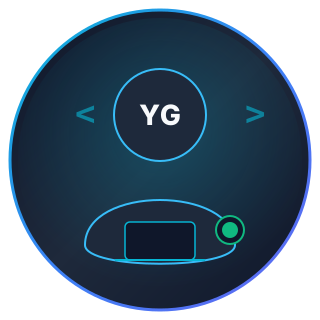

# Yash Goyal - Developer Portfolio Website

A modern, responsive, high-performance developer portfolio website designed with a dark aesthetic, electric cyan/blue accents, and clean typography. Built using semantic HTML5, modern CSS3, and vanilla JavaScript (ES6+).

---

## 🚀 Live Preview & Quick Start

### 1. View Directly in Any Browser
Simply open the file directly:
- Double-click `index.html`, or right-click `index.html` and select **Open with Google Chrome / Microsoft Edge / Firefox**.

### 2. Run with Python Local Server (Optional)
Run this command from inside the `yash-goyal-portfolio` folder:
```bash
python -m http.server 3000
```
Then visit: `http://localhost:3000`

---

## 📁 Project Structure

```
yash-goyal-portfolio/
│
├── index.html                    # Main semantic HTML structure
├── README.md                     # Documentation & personalization guide
│
├── css/
│   └── style.css                 # CSS custom properties, responsive design, dark theme
│
├── js/
│   └── main.js                   # Mobile navigation, scrollspy, modals, toast notifications
│
└── assets/
    ├── images/
    │   ├── favicon.svg           # Branded <YG/> favicon
    │   ├── profile-placeholder.svg # Minimalist developer avatar
    │   ├── project-guess-number.svg# Python game preview graphic
    │   ├── project-dsa-practice.svg# C++ DSA preview graphic
    │   ├── project-portfolio.svg   # Portfolio preview graphic
    │   └── project-ai-ml.svg       # Upcoming AI/ML project preview graphic
    └── resume-placeholder.pdf    # Placeholder PDF for resume download
```

---

## 🛠️ How to Personalize Your Portfolio

### 1. Update Your Email & LinkedIn
Open `index.html` in VS Code and search for:
- `your.email@example.com` → replace with your real email (e.g. `yash.goyal@gmail.com`).
- `linkedin.com/in/your-profile` → replace with your actual LinkedIn profile link.

### 2. Add Your Resume PDF
1. Export your resume as a PDF file.
2. Place it in the `assets/` folder and name it `resume.pdf`.
3. In `index.html`, update the download links:
   ```html
   <a href="assets/resume.pdf" download="Yash_Goyal_Resume.pdf" class="btn btn-primary">
   ```

### 3. (Optional) Add Your Profile Photo
If you wish to use an actual photo instead of the clean developer avatar:
1. Save your photo in `assets/images/profile.jpg`.
2. In `index.html`, change:
   ```html
   
   ```
   to:
   ```html
   
   ```

### 4. Connect Contact Form to Your Email
The contact form currently validates submissions and shows a confirmation toast notification in frontend demo mode. To receive incoming emails in your inbox for free:

**Option A: Using Formspree (Free & takes 2 minutes)**
1. Sign up for free at [https://formspree.io](https://formspree.io).
2. Create a new form and copy your form endpoint URL (e.g., `https://formspree.io/f/xyzabcde`).
3. In `index.html`, update `<form id="contact-form">` to:
   ```html
   <form id="contact-form" action="https://formspree.io/f/YOUR_FORM_ID" method="POST">
   ```

---

## 🌐 How to Deploy to GitHub Pages for Free

Since your GitHub username is `Yashgoyal0`, you can host this portfolio completely free:

1. Create a new repository on GitHub named `portfolio` (or `Yashgoyal0.github.io`).
2. Push this project to GitHub:
   ```bash
   git init
   git add .
   git commit -m "Initial commit: Yash Goyal Developer Portfolio"
   git branch -M main
   git remote add origin https://github.com/Yashgoyal0/portfolio.git
   git push -u origin main
   ```
3. In your GitHub repository:
   - Go to **Settings** > **Pages**
   - Under **Build and deployment**, select source: **Deploy from a branch**
   - Select branch: `main` / `root` and click **Save**
4. Your site will be live at `https://Yashgoyal0.github.io/portfolio`!

---

## ✨ Features Included

- **Dark Theme Aesthetic**: Deep space slate navy palette with electric cyan and blue glow highlights.
- **Responsive Layout**: Designed for mobile (320px+), tablet, laptop, and ultra-wide screens.
- **Scrollspy Navigation**: Sticky header that detects and highlights the current section as you scroll.
- **Interactive Modals**: Includes a live interactive "Guess the Number" game runner and Resume previewer.
- **Zero Heavy Dependencies**: Pure vanilla HTML/CSS/JS with zero build steps required.
- **SEO & Social Share Ready**: Complete OpenGraph, Twitter Cards, and semantic meta tags.
